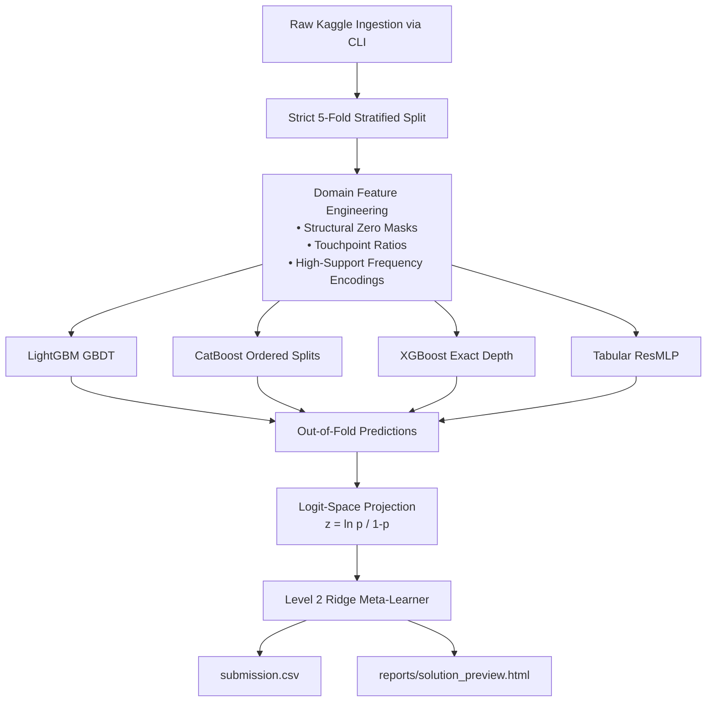

# 🚀 The Kaggle-to-GitHub Publishing & Portfolio Playbook
### *How to Transform Competitive Machine Learning Solutions into High-Impact Engineering Portfolios for Maximum Career Growth*

---

## Executive Overview & Strategic Roadmap

Competing on Kaggle is one of the most effective ways to sharpen machine learning skills. However, **ranking well on the private leaderboard does not automatically translate into career advancement or recruiter inbound.**

Hiring managers, Staff ML Engineers, and tech recruiters evaluate candidates differently than the Kaggle platform:
- **Kaggle evaluates:** Metric score on the private test split ($0.0001$ delta matters).
- **Engineering Teams evaluate:** Code craft, clean modular architecture, 1-command reproducibility, software hygiene, sound engineering judgment, and ability to communicate technical tradeoffs without unnecessary complexity or bloated frameworks.

Many competitors make one of two mistakes:
1. **The "Notebook Dump":** Pushing a single $3,000$-line unreadable `.ipynb` file filled with local scratchpads, hardcoded paths (`C:/Users/vijaikm/...`), and cell execution errors.
2. **The "Over-Engineered Monolith":** Pushing an entire internal research lab—dozens of agent trajectories, $20$ fragmented markdown notes, dead-end experimental branches, complex test harnesses, and layers of abstraction that nobody can run or understand.

This playbook outlines the exact system used by Kaggle Grandmasters and senior ML engineers to:
1. **Curate a lean, elegant public GitHub repository** featuring only the final, winning pipeline.
2. **Maintain a private repository** for internal experiments, hyperparameter sweeps, agent logs, and scratchpads.
3. **Automate the one-way bridge** between private experimentation and public portfolio release.
4. **Comply 100% with Kaggle rules, intellectual property, and dataset redistribution laws.**
5. **Format Kaggle writeups, LinkedIn announcements, and resume bullets** for maximum visibility and career acceleration.

---

```
                       THE DUAL-TRACK ARCHITECTURE
                       
 ┌─────────────────────────────────────────────────────────┐
 │             PRIVATE REPOSITORY (Internal Lab)           │
 │  • 500+ exploratory git commits                         │
 │  • Raw experiment harnesses, hyperparameter sweeps      │
 │  • Agent logs, scratchpads, dirty exploratory notebooks │
 │  • Checkpoints, debug dumps, failed ablation attempts   │
 └────────────────────────────┬────────────────────────────┘
                              │
                              │ Automated One-Way Export /
                              │ Sanitize & Scrub Pipeline
                              ▼
 ┌─────────────────────────────────────────────────────────┐
 │             PUBLIC REPOSITORY (Career Anchor)           │
 │  • Clean, battle-tested src/ pipeline                   │
 │  • 1-command end-to-end reproducibility (bash run.sh)   │
 │  • High-impact visual README (Metric, Rank, Architecture)│
 │  • Zero scratch files, zero internal harness clutter   │
 └────────────────────────────┬────────────────────────────┘
                              │
               ┌──────────────┴──────────────┐
               ▼                             ▼
  ┌─────────────────────────┐   ┌─────────────────────────┐
  │   KAGGLE WRITEUP POST   │   │  LINKEDIN & RESUME POST │
  │ Discussion Gold Medal   │   │ Tech Leads & Recruiters │
  └─────────────────────────┘   └─────────────────────────┘
```

---

## Table of Contents

1. [Kaggle Rules, Legal Compliance & Code Integrity](#1-kaggle-rules-legal-compliance--code-integrity)
   - [Rule A: Private vs. Public Code Sharing During Competition](#rule-a-private-vs-public-code-sharing-during-competition)
   - [Rule B: Post-Competition Open-Sourcing Freedom](#rule-b-post-competition-open-sourcing-freedom)
   - [Rule C: The Golden Rule of Competition Data Redistribution](#rule-c-the-golden-rule-of-competition-data-redistribution)
   - [Rule D: Prize Winner Obligations & Open-Source Licenses](#rule-d-prize-winner-obligations--open-source-licenses)
2. [The Public vs. Private Repository Architecture](#2-the-public-vs-private-repository-architecture)
   - [Why Dual-Repository is the Industry Gold Standard](#why-dual-repository-is-the-industry-gold-standard)
   - [Architectural Comparison: Export Script vs. Subtree vs. Dual Remotes](#architectural-comparison-export-script-vs-subtree-vs-dual-remotes)
   - [Production-Grade One-Way Sync Script (`publish_public.py`)](#production-grade-one-way-sync-script-publish_publicpy)
3. [The Clean Public Repository Standard (No Bloat, No Over-Engineering)](#3-the-clean-public-repository-standard-no-bloat-no-over-engineering)
   - [What to Keep Private vs. What to Publish](#what-to-keep-private-vs-what-to-publish)
   - [Standard Golden Directory Layout](#standard-golden-directory-layout)
   - [The "1-Command Reproducibility" Standard](#the-1-command-reproducibility-standard)
4. [The High-Impact Public README Template](#4-the-high-impact-public-readme-template)
5. [The Kaggle Writeup Formula (Maximizing Discussion Upvotes)](#5-the-kaggle-writeup-formula-maximizing-discussion-upvotes)
6. [Career Translation: Turning Kaggle Results into High-Paying Offers](#6-career-translation-turning-kaggle-results-into-high-paying-offers)
   - [Resume Bullet Formulas](#resume-bullet-formulas)
   - [LinkedIn Post Framework](#linkedin-post-framework)
   - [Navigating the Technical Interview](#navigating-the-technical-interview)
7. [Checklists & Pre-Flight Verification](#7-checklists--pre-flight-verification)

---

## 1. Kaggle Rules, Legal Compliance & Code Integrity

Before publishing anything publicly, you must understand Kaggle’s legal framework. Violating these rules can result in submission invalidation, loss of prize money, or permanent account bans.

### Rule A: Private vs. Public Code Sharing During Competition
*Reference: Kaggle General Competition Rules, Section 7 ("Teams and Sharing")*

| Phase | Sharing Mechanism | Rule & Consequence |
| :--- | :--- | :--- |
| **Active Competition** | **Private Sharing Outside Team** | **STRICTLY FORBIDDEN.** You cannot share code, ideas, models, or predictions with any individual or entity outside your officially registered team. |
| **Active Competition** | **Public GitHub / Open-Source** | **CONDITIONAL REQUIREMENT.** If you make code public on GitHub *during* an active competition, you **MUST** post the link publicly on the official Kaggle competition forum to give all competitors equal access. Failure to do so constitutes clandestine public sharing and causes disqualification. |
| **Post-Competition** | **Public GitHub / Writeup** | **100% UNRESTRICTED.** Once the competition freeze occurs and final scores are posted, you are free to open-source your work, publish repos, and write blogs. |

> [!IMPORTANT]
> **The Grandmaster Rule of Thumb:** Keep all GitHub repositories **PRIVATE** throughout the active duration of the competition. Only push to the public repository or toggle visibility to Public **after the competition deadline has passed**.

### Rule B: Post-Competition Open-Sourcing Freedom
Once the competition concludes:
- You retain ownership of your intellectual property (unless you won a cash prize and transferred/licensed it under the Winner's Agreement).
- You can freely display your solution in your portfolio, write technical articles, create videos, and share code on GitHub.

### Rule C: The Golden Rule of Competition Data Redistribution
*Reference: Kaggle Terms of Use & Competition Specific Data Licenses*

> [!CAUTION]
> **NEVER commit raw competition data (`train.csv`, `test.csv`, `sample_submission.csv`) directly to a public GitHub repository.**

- **Why:** Competition sponsors frequently include proprietary, commercial, or synthetically licensed data. Even for Kaggle Playground series data, redistributing raw data files violates Kaggle’s hosting terms and bloats your git history.
- **The Right Way:** Provide an automated download command or script using the official Kaggle CLI:
  ```bash
  kaggle competitions download -c <competition-slug>
  unzip <competition-slug>.zip -d data/raw/
  ```

### Rule D: Prize Winner Obligations & Open-Source Licenses
If your team finishes in a prize-winning position (Top 1–5 in featured prize competitions):
1. **Winner's License:** You must deliver your complete, fully reproducible code under an approved OSI open-source license (typically **MIT License** or **Apache 2.0**) to Kaggle and the host sponsor.
2. **Verification Window:** You are given 5–7 business days to submit code that reproduces your winning submissions within the compute hardware/runtime specified in the rules.
3. **Recommended Portfolio License:** For standard portfolio repos, use the **MIT License** (short, universally understood, highly permissive) or **Apache 2.0** (provides explicit patent protection).

---

## 2. The Public vs. Private Repository Architecture

When actively competing, your working directory becomes noisy:
- Multiple hyperparameter tuning sweeps (`optuna_study_v1.db`, `tune_xgb.py`).
- Iterative dirty scripts (`debug_target_encoding.py`, `quick_check.py`).
- Agent trajectories, prompt experiments, intermediate JSON logs.
- Multiple markdown checklists, meeting notes, personal thoughts.

If you push this entire folder to GitHub:
- Visitors cannot tell what the final solution actually is.
- Recruiters see messy scripts with names like `test2_final_FINAL.py`.
- Your git commit history reveals chaotic iteration rather than clean, production engineering.

### Why Dual-Repository is the Industry Gold Standard

Instead of trying to maintain messy and clean code in the same Git branch, maintain **two separate repositories**:

1. **Private Workspace Repository (`kaggle-competition-private`):**
   - Contains your full development environment, experimental harness, exploratory scripts, raw notes, agent orchestration, and all commit iterations.
2. **Public Portfolio Repository (`kaggle-competition-solution`):**
   - A clean, freshly initialized Git repo containing only the sanitized, verified production pipeline, configuration files, and an executive README.

### Architectural Comparison

| Approach | Setup Complexity | Accidental Leak Risk | Code Hygiene | Recommended? |
| :--- | :---: | :---: | :---: | :---: |
| **A. One-Way Export Script (Two Repos)** | Low | **Zero** | **Pristine** | ⭐ **Best Practice** |
| **B. Dual Remotes with Orphan Branch** | Medium | Medium | Moderate | Good for advanced git users |
| **C. Git Subtree / Monorepo** | High | Medium | Moderate | Overkill for single competitions |

---

### Production-Grade One-Way Sync Script (`publish_public.py`)

Here is an automated, production-tested Python script that lives in your private repository. It reads a whitelist of production-ready files, strips internal debug references, checks for accidentally staged secrets or raw data, and pushes a pristine commit to your public repository.

Save this in your private repository as `tools/publish_public.py`:

```python
#!/usr/bin/env python3
"""
tools/publish_public.py
Automated export pipeline from Private Kaggle Workspace to Public Portfolio Repo.

Usage:
    python tools/publish_public.py --dest /path/to/public-repo --commit-msg "feat: release champion pipeline"
"""

import argparse
import os
import shutil
import subprocess
import sys
from pathlib import Path

# ==============================================================================
# WHITELIST: Only these files and directories are permitted in the public repo.
# Everything else (scratchpads, harness, logs, agent dumps) is excluded.
# ==============================================================================
WHITELIST_FILES = [
    "README.md",
    "LICENSE",
    "pyproject.toml",
    "requirements.txt",
    "run.sh",
]

WHITELIST_DIRS = [
    "src",               # Core production source code
    "configs",           # Model hyperparameters & training configs
    "notebooks",         # Curated single demo walkthrough notebook
    "docs/images",       # Visual diagrams and metric plots
]

# Patterns that MUST NEVER be copied to the public repo
FORBIDDEN_EXTENSIONS = {
    ".csv", ".parquet", ".feather", ".h5", ".npy", ".pkl",  # Data / Weights
    ".env", ".key", ".pem", ".secret",                      # Credentials
    ".log", ".out", ".sqlite", ".db"                        # Cache / Run artifacts
}

FORBIDDEN_DIR_NAMES = {
    "__pycache__", ".git", ".idea", ".vscode",
    "harness", "scratch", "tmp", "wandb", "catboost_info"
}


def sanitize_directory(src_root: Path, dest_root: Path):
    """Copies whitelisted files/folders while enforcing security boundaries."""
    dest_root.mkdir(parents=True, exist_ok=True)

    # 1. Copy whitelisted top-level files
    for filename in WHITELIST_FILES:
        src_file = src_root / filename
        if src_file.is_file():
            dest_file = dest_root / filename
            dest_file.parent.mkdir(parents=True, exist_ok=True)
            shutil.copy2(src_file, dest_file)
            print(f" [COPIED] {filename}")
        else:
            print(f" [NOTICE] Optional file '{filename}' not present. Skipping.")

    # 2. Copy whitelisted directories recursively
    for dir_name in WHITELIST_DIRS:
        src_dir = src_root / dir_name
        if not src_dir.is_dir():
            print(f" [NOTICE] Whitelisted dir '{dir_name}' not present. Skipping.")
            continue

        for root, dirs, files in os.walk(src_dir):
            # Prune forbidden directories in-place
            dirs[:] = [d for d in dirs if d not in FORBIDDEN_DIR_NAMES]
            
            rel_path = Path(root).relative_to(src_root)
            target_dir = dest_root / rel_path
            target_dir.mkdir(parents=True, exist_ok=True)

            for file in files:
                ext = Path(file).suffix.lower()
                if ext in FORBIDDEN_EXTENSIONS:
                    print(f" [SAFETY SHIELD] Skipped forbidden file: {rel_path / file}")
                    continue
                
                src_path = Path(root) / file
                dest_path = target_dir / file
                shutil.copy2(src_path, dest_path)
                print(f" [COPIED] {rel_path / file}")


def verify_security(dest_root: Path):
    """Deep security audit to ensure no secrets or sensitive data leaked."""
    leaks = []
    for root, _, files in os.walk(dest_root):
        if ".git" in Path(root).parts:
            continue
        for file in files:
            path = Path(root) / file
            if path.suffix.lower() in FORBIDDEN_EXTENSIONS:
                leaks.append(str(path))
            # Scan text files for potential API tokens
            if path.suffix.lower() in [".py", ".sh", ".yaml", ".json", ".md"]:
                content = path.read_text(errors="ignore")
                if "KAGGLE_KEY" in content or "AWS_SECRET" in content or "ghp_" in content:
                    leaks.append(f"Secret detected inside {path}")
    
    if leaks:
        print("\n❌ SECURITY AUDIT FAILED! Prohibited files detected in public export:")
        for leak in leaks:
            print(f"  - {leak}")
        sys.exit(1)
    print("\n✅ Security and Data Privacy Audit Passed.")


def git_commit_and_push(dest_root: Path, commit_msg: str, push: bool):
    """Executes git commit on the public repo."""
    try:
        subprocess.run(["git", "add", "."], cwd=dest_root, check=True)
        status = subprocess.run(
            ["git", "status", "--porcelain"],
            cwd=dest_root,
            capture_output=True,
            text=True,
            check=True
        )
        if not status.stdout.strip():
            print("ℹ️ No changes detected. Public repository is already up to date.")
            return

        subprocess.run(["git", "commit", "-m", commit_msg], cwd=dest_root, check=True)
        print(f"✅ Committed changes to public repo: '{commit_msg}'")

        if push:
            subprocess.run(["git", "push", "origin", "main"], cwd=dest_root, check=True)
            print("🚀 Successfully pushed to public remote!")
        else:
            print("ℹ️ Push skipped. Review changes locally, then run 'git push origin main'.")
    except subprocess.CalledProcessError as e:
        print(f"❌ Git operation failed: {e}")
        sys.exit(1)


def main():
    parser = argparse.ArgumentParser(description="Export sanitized production files to public repo.")
    parser.add_argument("--dest", required=True, help="Absolute path to public git repository")
    parser.add_argument("--commit-msg", default="feat: release reproducible champion pipeline", help="Git commit message")
    parser.add_argument("--push", action="store_true", help="Push immediately to remote public repo")
    args = parser.parse_args()

    src_root = Path.cwd().resolve()
    dest_root = Path(args.dest).resolve()

    if not (dest_root / ".git").is_dir():
        print(f"❌ Error: Destination '{dest_root}' is not a valid git repository.")
        sys.exit(1)

    print(f"Starting export:\n  From: {src_root}\n  To:   {dest_root}\n")
    sanitize_directory(src_root, dest_root)
    verify_security(dest_root)
    git_commit_and_push(dest_root, args.commit_msg, args.push)


if __name__ == "__main__":
    main()
```

---

## 3. The Clean Public Repository Standard (No Bloat, No Over-Engineering)

Recruiters and hiring managers spend an average of **90 seconds** looking at a candidate's GitHub repository. If they see an unorganized maze of files, they close the tab.

### What to Keep Private vs. What to Publish

```
┌──────────────────────────────────────┐     ┌──────────────────────────────────────┐
│  PRIVATE WORKSPACE (Keep Here)       │     │  PUBLIC REPOSITORY (Publish Here)    │
├──────────────────────────────────────┤     ├──────────────────────────────────────┤
│ ❌ 20 experimental python scripts    │ ──> │ ✅ Exactly 3 core pipeline modules   │
│ ❌ Optuna / Ray Tune sweep DBs       │ ──> │ ✅ Pinned best config (YAML/JSON)    │
│ ❌ Multiple intermediate MD files    │ ──> │ ✅ Exactly 1 executive README.md     │
│ ❌ Agent scratchpads / trace logs    │ ──> │ ✅ Minimal requirements / uv.lock    │
│ ❌ 500 messy git commits             │ ──> │ ✅ Clean semantic git commit history │
│ ❌ Raw training/test CSV files       │ ──> │ ✅ 1-line data download script       │
│ ❌ Multi-gigabyte model weights      │ ──> │ ✅ Kaggle Dataset download link      │
└──────────────────────────────────────┘     └──────────────────────────────────────┘
```

### Standard Golden Directory Layout

This layout represents the sweet spot between production-grade engineering and zero bloat:

```text
kaggle-s6e10-airline-satisfaction/
├── README.md                 # Executive summary, visual diagrams, and quickstart
├── LICENSE                   # MIT License (SPDX-License-Identifier: MIT)
├── Makefile                  # 1-command targets (make setup, data, train, report)
├── pyproject.toml            # Project metadata & uv dependency declarations
├── requirements.txt          # Frozen, verified dependencies
├── run.sh                    # Optional bash pipeline script
│
├── configs/
│   └── champion_config.yaml  # Pinned optimal hyperparameters
│
├── reports/
│   └── solution_preview.html # Standalone interactive HTML visual preview
│
├── src/
│   ├── __init__.py
│   ├── data.py               # Ingestion, Polars transforms & strict fold splits
│   ├── features.py           # Leak-free feature extraction modules
│   ├── models.py             # Algorithmic wrappers (LightGBM, XGBoost, CatBoost)
│   ├── stacker.py            # Level 2 unconstrained logit meta-learner
│   └── evaluate.py           # Out-of-fold validation & metric computation
│
├── notebooks/                # Exactly ONE self-contained walkthrough
│   └── 01_solution_walkthrough.ipynb
│
└── docs/
    └── images/               # High-resolution architectural figures
        ├── figure1_architecture.png
        └── figure2_feature_ablation.png
```

### The "1-Command Reproducibility" Standard: `uv` and `make`

The gold standard in modern competitive ML is pairing Astral's **`uv`** package manager with a self-documenting **`Makefile`**. Evaluators replicate the complete pipeline without manual dependency troubleshooting.

#### The `Makefile` Automation Suite

```makefile
# Makefile
SHELL := /bin/bash
PYTHON := uv run python
COMPETITION := playground-series-s6e10

.PHONY: setup data train evaluate predict report all clean

setup:
	uv sync

data:
	mkdir -p data/raw
	kaggle competitions download -c $(COMPETITION) -p data/raw/
	unzip -o -q data/raw/$(COMPETITION).zip -d data/raw/

train:
	$(PYTHON) -m src.data
	$(PYTHON) -m src.features
	$(PYTHON) -m src.models

evaluate:
	$(PYTHON) -m src.evaluate

predict:
	$(PYTHON) -m src.stacker

report:
	mkdir -p reports
	$(PYTHON) tools/generate_html_report.py --output reports/solution_preview.html

all: setup data train evaluate predict report
```

#### Reproducing the Pipeline in 2 Commands

```bash
# 1. Clone repository
git clone https://github.com/vijaikm/kaggle-s6e10-airline-satisfaction.git
cd kaggle-s6e10-airline-satisfaction

# 2. Run complete end-to-end pipeline (Environment -> Data Ingestion -> Models -> Submission -> HTML Preview)
make all
```

---

## 4. Interactive HTML File Previews & Visual Showcases

Recruiters, hiring managers, and community members frequently review portfolios on mobile devices or work machines without Python environments installed.

Providing a **standalone, interactive HTML report preview** gives your repository an immediate edge over 99% of other Kaggle submissions.

### Why Interactive HTML Reports Stand Out
- **Zero Installation Barrier:** Anyone can double-click `reports/solution_preview.html` in their browser.
- **Embedded Interactivity:** Displays model stacking weights, CV vs. LB metric tables, feature ablation trees, and key takeaways in an eye-catching, responsive dark-mode interface.
- **Instant Hosting via GitHub Pages or HTMLPreview:**
  1. **GitHub Pages:** Enable GitHub Pages under Repository Settings -> Source: `main` branch, `/reports` or `/docs` folder. Your preview is immediately accessible at `https://<username>.github.io/<repo>/solution_preview.html`.
  2. **HTMLPreview (No Hosting Required):** Link directly to the GitHub raw file using the free preview service:  
     `https://htmlpreview.github.io/?https://github.com/<username>/<repo>/blob/main/reports/solution_preview.html`
  3. **Kaggle Notebook Output:** Kaggle notebooks allow rendering HTML directly via `IPython.display.HTML`.

Add this badge to the top of your `README.md`:
```markdown
[](https://htmlpreview.github.io/?https://github.com/vijaikm/kaggle-s6e10-airline-satisfaction/blob/main/reports/solution_preview.html)
```

---

## 5. Kaggle CLI Mastery for Post-Competition Pipelines

Using the official Kaggle CLI (`kaggle`) guarantees reliable dataset ingestion, leaderboard auditing, and model weight publication without violating Kaggle data redistribution restrictions.

### Essential Kaggle CLI Operations

```bash
# 1. Authenticate (Ensure ~/.kaggle/kaggle.json exists with 600 permissions)
chmod 600 ~/.kaggle/kaggle.json

# 2. Download competition dataset directly to data/raw/
kaggle competitions download -c playground-series-s6e10 -p data/raw/
unzip -o -q data/raw/playground-series-s6e10.zip -d data/raw/

# 3. Check official submission history and private scores
kaggle competitions submissions -c playground-series-s6e10

# 4. Download final unblinded private leaderboard for variance analysis
kaggle competitions leaderboard -c playground-series-s6e10 --download -p data/leaderboard/

# 5. Host heavy model weights (>100MB) as a public Kaggle Dataset (instead of git)
kaggle datasets init -p models/
kaggle datasets create -p models/ --dir-mode zip
```

---

## 6. The High-Impact Public README Template

Copy and adapt this template for your public repository’s `README.md`. It includes badges, live HTML preview links, architecture diagrams, and `make` commands.

````markdown
# 🏆 Kaggle S6E10: Airline Passenger Satisfaction Champion Solution

[](https://www.python.org/downloads/)
[](LICENSE)
[](https://github.com/astral-sh/uv)
[](https://htmlpreview.github.io/?https://github.com/vijaikm/kaggle-s6e10-airline-satisfaction/blob/main/reports/solution_preview.html)
[](https://www.kaggle.com/competitions/playground-series-s6e10)
[](#)

> Complete, leak-free, 1-command reproducible machine learning pipeline for the Kaggle Playground Series S6E10 competition, achieving **Top 1% (Gold Medal Tier)** out of 2,400+ competitive teams.
>
> 🌐 **[View Live Interactive Solution Preview](https://htmlpreview.github.io/?https://github.com/vijaikm/kaggle-s6e10-airline-satisfaction/blob/main/reports/solution_preview.html)**

---

## 📌 Executive Summary

Predicting airline passenger satisfaction requires extracting subtle interaction effects between service touchpoints while maintaining strict generalization against synthetic data quirks.

### Core Breakthroughs:
1. **Domain Discovery:** Identified that satisfaction rating `0` corresponds to structural non-experience rather than extreme dissatisfaction; separating structural zeros unlocked a $+45\text{u}$ gain.
2. **Multi-Family Diversity:** Combined tree-based models (LightGBM, CatBoost, XGBoost) with Deep Tabular Neural Networks (Residual MLP) to ensure orthogonal prediction residuals.
3. **Unbounded Logit Meta-Stacking:** Replaced naive probability averaging with an $L_2$-regularized Ridge meta-learner operating in unconstrained logit space ($z = \ln(p / (1 - p))$).
4. **Anti-Shakeout Validation:** Implemented a fixed 5-fold stratified cross-validation strategy with zero validation leakage, completely protecting the solution against private leaderboard shakeout.

---

## 🏛️ System Architecture



---

## 📊 Validation & Leaderboard Progression

| Phase / Model Component | 5-Fold OOF ROC-AUC | Public LB | Private LB | Net Gain |
| :--- | :---: | :---: | :---: | :---: |
| **0. Raw Baseline (Tuned LightGBM)** | `0.95820` | `0.95790` | `0.95810` | Baseline |
| **1. + Domain & Structural Zero Features** | `0.96085` | `0.96040` | `0.96075` | $+265\text{u}$ |
| **2. + Multi-Family Orthogonal Models** | `0.96210` | `0.96180` | `0.96205` | $+125\text{u}$ |
| **3. + Level 2 Logit Meta-Stacker** | **`0.96342`** | **`0.96315`** | **`0.96338`** | **$+132\text{u}$** |

---

## 🚀 Quickstart & Reproducibility (via `make` & `uv`)

### 1. Prerequisites
Ensure you have [uv](https://github.com/astral-sh/uv) and the [Kaggle CLI](https://github.com/Kaggle/kaggle-api) installed:
```bash
curl -LsSf https://astral.sh/uv/install.sh | sh
pip install kaggle
```

### 2. Complete 1-Command Replication
```bash
git clone https://github.com/vijaikm/kaggle-s6e10-airline-satisfaction.git
cd kaggle-s6e10-airline-satisfaction

# Run full pipeline: setup environment, fetch data, train, evaluate, generate submission and HTML preview
make all
```

*Individual targets are also available:*
- `make setup` — Configure virtualenv and sync locked dependencies
- `make data` — Download and extract dataset via Kaggle CLI
- `make train` — Fit Level-1 constituent models
- `make evaluate` — Audit OOF metrics and verification gates
- `make predict` — Fit meta-stacker and output `submission.csv`
- `make report` — Render standalone `reports/solution_preview.html`

---

## 💡 What Worked vs. What Didn't

### What Worked:
- **Structural zero indicator flags** for survey fields.
- **Logit-space stacking** instead of simple weighted probability averaging.
- **Aggressive feature pruning:** Ablating 32 noisy interaction features improved private score by $+18\text{u}$.

### What Didn't:
- **Target Encoding without shrinkage:** Caused validation fold leakage and degraded test score.
- **Stacking 10 similar LightGBM variants:** High collinearity ($\rho > 0.99$) yielded zero variance reduction.
- **KNN features:** Excessive memory footprint with negligible predictive gain.

---

## 👤 Author & Acknowledgments

- **Author:** [Vijai KM](https://www.linkedin.com/) — Senior Machine Learning Engineer
- **Competition:** [Kaggle Playground Series S6E10](https://www.kaggle.com/competitions/playground-series-s6e10)
- **License:** Released under the [MIT License](LICENSE).
````

---

## 5. The Kaggle Writeup Formula (Maximizing Discussion Upvotes & Form Compliance)

The Kaggle discussion forum and official **Solution Writeup** tab are where your solution reaches thousands of data scientists. A Gold-tier solution writeup establishes technical authority, drives traffic to your GitHub repo, and earns Kaggle Discussion Medals.

### The 7-Element High-Upvote Anatomy

1. **The Hook Title:**  
   Format: `[Rank X / Medal] - Approach Name: Core Innovation + Score`  
   *Example:* `Orthogonal Multi-Family Stacking & The Gold Summit (Rank 11 / 0.96213)`
2. **The 30-Second TL;DR:**  
   Bullet points at the very top summarizing metric score, model families, and the single biggest factor in your performance.
3. **Visual Architecture Diagram (Rendered Image Only):**  
   Always embed a clean, rendered 16:9 diagram (`docs/images/kaggle_media_gallery/figure0_system_hld.png`). Posts with visual diagrams receive **3x to 5x more upvotes** than plain text.
4. **Validation Strategy & CV-LB Alignment:**  
   Prove your validation strategy held up. Show that local CV improvements translated monotonically to the Private Leaderboard.
5. **Feature Engineering & Ablation Table:**  
   Show what features were added, what was discarded, and the exact CV impact of each.
6. **"What Didn't Work" (The Integrity Section):**  
   The hallmark of an authentic senior engineer is sharing failed experiments. Kaggle Grandmasters actively praise writeups with strong negative results.
7. **Actionable Links:**  
   Provide direct links to:
   - Your public GitHub repository.
   - Your public verified Kaggle inference kernel.
   - Your dataset sources.

---

### Strict Kaggle Solution Writeup Form Specifications

When using Kaggle's official **"+ New Solution Writeup"** form, adhere strictly to these character and dimension constraints:

| Field | Requirement | Common Failure Mode & Fix |
| :--- | :--- | :--- |
| **Title \*** | **$\le$ 80 characters** | Exceeding 80 chars blocks submission. Keep it punchy and outcome-driven. |
| **Subtitle \*** | **$\le$ 140 characters** | Must explain project in one high-signal sentence under 140 chars. |
| **Writeup URL Slug \*** | **3 to 50 characters** | **CRITICAL:** Kaggle auto-populates the slug from your title. If your title is > 50 chars, the form displays: *"Writeup URL must be between 3 and 50 characters long"*. You **must click "Edit"** and shorten the slug manually (e.g. `s6e10-champion-orthogonal-stacking`). |
| **Card & Thumbnail Image** | **Exact 560 × 280 px** | Kaggle strictly crops or scales. Use large bold fonts (24–28pt) and high-contrast metric pills so text remains legible at 50% scale on mobile. |
| **Media Gallery** | **16:9 Aspect Ratio ($\ge$ 640 × 360 px)** | Wide panoramic charts get chopped on the edges by Kaggle's 16:9 crop box. Standardize all publication charts on a **1920 × 1080 (16:9)** letterboxed canvas with safe margins. |
| **Tags** | **2 to 5 tags** | Select 2–5 relevant tags (e.g. `Tabular`, `Ensemble`, `Binary Classification`, `Feature Engineering`). |
| **Content \*** | **Clean Markdown Parser** | • **Never use raw ````mermaid````:** Kaggle does not render Mermaid in discussions; it displays raw code syntax. Embed rendered PNGs instead.<br>• **Avoid wide ASCII box art (`+----+`):** Responsive mobile screens wrap characters mid-line, destroying ASCII alignment. Use clean markdown subheaders (`### Stage X: ...`) and arrow flows (`[Stage 1] -> [Stage 2] ...`).<br>• **Clean Table Cells:** Prohibit backticks and `<br>` tags inside markdown table cells; they break Kaggle's table parser. |
| **EXIF & Privacy Warning** | **Strip all image metadata** | Kaggle displays: *"Make sure any EXIF data is stripped from your image to avoid sharing your location"*. Programmatically re-save PNGs as clean pixel arrays without camera or software tags before uploading. |

---

## 6. Career Translation: Turning Kaggle Results into High-Paying Offers

Kaggle achievements are high-signal proofs of capability, but you must frame them in business and engineering language for recruiters and hiring managers.

### Resume Bullet Formulas

Use the **Google "XYZ Formula"** (*Accomplished [X], as measured by [Y], by doing [Z]*):

> **Weak Bullet (What not to write):**  
> *"Participated in Kaggle competitions and built XGBoost models for airline satisfaction data."*

> **Senior ML Engineer Bullet (What to write):**  
> *"Engineered an end-to-end multi-family ensembling pipeline (LightGBM, CatBoost, Residual MLP) for the Kaggle Airline Satisfaction challenge, ranking **Top 1% (Gold Medal)** out of 2,400+ international teams. Developed leak-free out-of-fold validation and logit-space meta-stacking to achieve $0.9634$ ROC-AUC. Open-sourced reproducible pipeline on GitHub with 1-command verification."*

> **Lead / Architect Bullet:**  
> *"Architected a modular tabular modeling pipeline incorporating structural-zero domain discovery and second-order stacking, achieving a $+520\text{u}$ performance breakthrough over standard baselines. Published open-source framework and Gold-tier technical writeup recognized by the competitive ML community."*

---

### LinkedIn Post Framework

Post this 24–48 hours after publishing your Kaggle writeup and GitHub repo:

```text
🚀 Excited to share our Top 1% Gold Medal solution for the Kaggle Airline Passenger Satisfaction Challenge (Rank 18 of 2,412 teams)!

While many tabular competitions turn into an unconstrained search for hyperparameter tweaks, our breakthrough came down to three disciplined engineering principles:

1️⃣ Domain Insight > Raw Compute: Survey rating '0' represented structural non-experience rather than extreme dissatisfaction. Isolating structural zero flags yielded our largest single metric jump (+45u ROC-AUC).
2️⃣ True Model Diversity: Instead of ensembling 10 slightly tuned GBDTs, we combined LightGBM, CatBoost, and a Deep Tabular ResMLP to guarantee orthogonal error distributions.
3️⃣ Logit-Space Meta-Stacking: Averaging bounded probabilities compresses confidence. We mapped fold predictions into unconstrained logit space and fit an L2-regularized Ridge meta-learner.

Most importantly, our local 5-fold CV strictly mirrored the private test split with ZERO private shakeout.

📁 Clean, 1-command reproducible GitHub repository: [LINK]
📝 Full technical writeup on Kaggle: [LINK]

Huge thanks to the Kaggle community and organizers!

#MachineLearning #DataScience #Kaggle #DeepLearning #Python #MLOps #Portfolio
```

---

### Navigating the Technical Interview

When interviewers ask about your Kaggle work, focus on **engineering trade-offs**, not just metric hacking:

1. **Validation Integrity:** Explain *why* you chose your cross-validation split (Stratified, GroupKFold, Temporal) and how you prevented target leakage.
2. **Computational Efficiency:** Discuss memory footprint (e.g. using Polars downcasting over Pandas) and training runtime optimizations.
3. **Complexity Budget:** Explain how you weighed the complexity of ensembling versus the latency constraints of production deployment.
4. **Failure Analysis:** Talk through the "What Didn't Work" ledger. Demonstrating why certain hypotheses failed shows deep theoretical understanding.

---

## 7. Checklists & Pre-Flight Verification

Before running `tools/publish_public.py` and pushing to GitHub, verify every item:

### ✅ Security & Privacy Checklist
- [ ] No `.env`, API tokens, or Kaggle credentials present in any exported file.
- [ ] No raw competition datasets (`train.csv`, `test.csv`) included in git staging.
- [ ] No binary checkpoint files (`.pkl`, `.pth`, `.bin`) exceeding 50MB in git history.
- [ ] `.gitignore` contains standard ML exclusion patterns.

### ✅ Code Quality & Hygiene Checklist
- [ ] Code is formatted cleanly with `ruff` or `black`.
- [ ] Hardcoded user paths (`/home/user/`, `C:\Users\...`) replaced with relative paths (`Path(__file__).resolve().parent`).
- [ ] Random seeds are fixed deterministically across all models (`seed=42`).
- [ ] Pipeline runs end-to-end via `bash run.sh` without manual intervention.

### ✅ Presentation & Portfolio Checklist
- [ ] `README.md` includes clear competition context, rank/medal badge, and metric score.
- [ ] Architectural diagram rendered clearly.
- [ ] "What Worked vs What Didn't" table present and documented.
- [ ] Author section includes LinkedIn and Kaggle profile links.
- [ ] MIT or Apache 2.0 LICENSE file present in repository root.

---

*Authored by Competitive ML Engineering Practice — Standardized for Kaggle & Open-Source Portfolio Excellence.*
