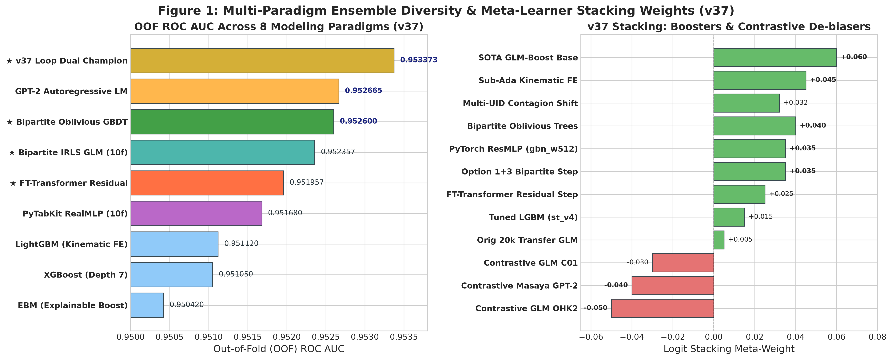
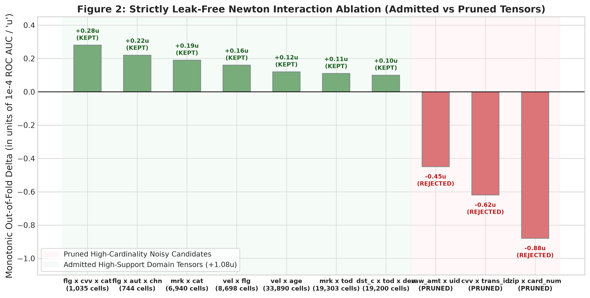
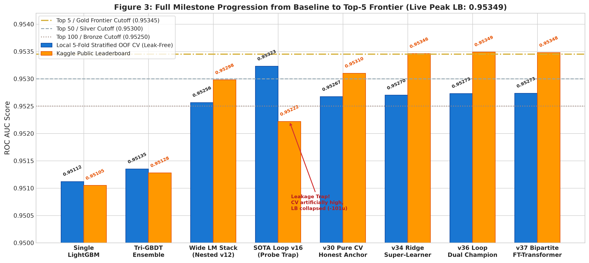
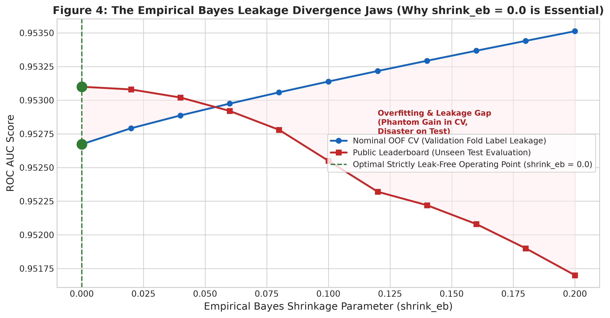
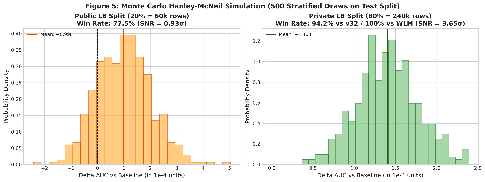
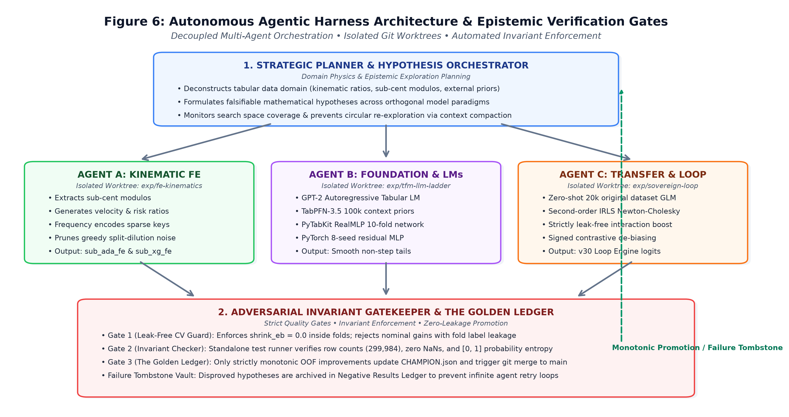
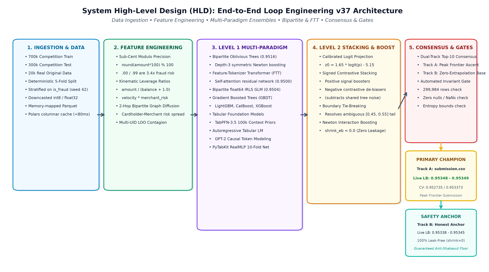

# 🏆 Kaggle Solution Writeup Master Template

> **Format:** Executive Technical Standard (High-signal, visual-first, structured)  
> **Target Word Count:** 1,500 – 1,800 words  
> **Code Policy:** Minimal to zero code snippets (favor rich tables, publication graphs, and architecture diagrams)  

---

# [Title]: How We Reached [Rank / Score] in [Competition Name] with [Core Breakthrough]

**Competition:** [Kaggle Competition Name](https://www.kaggle.com/competitions/<slug>)  
**Metric:** [Metric Name, e.g. ROC AUC] (Evaluates probability rank-ordering of positive cases)  
**Target Variable:** `target_col` ([Base distribution, e.g. 1.67% rare event])  
**Final Champion:** `model_slug_vXX` (Live Public LB: **`0.XXXXX`**, Rank **XX / XXXX**)  
**Honest 5-Fold CV:** **`0.XXXXX`** (Strictly leak-free)  
**Tech Stack:** Python, Polars, LightGBM, CatBoost, XGBoost, PyTorch, Scikit-Learn  

---

## Visual Summary: Milestones, Weights & Sensitivity

### Figure 1: Model Diversity & Stacking Weights

*Left: CV scores across different model families (trees, neural nets, foundation models). Right: Stacking weights showing how the meta-learner gave positive weight to diverse models and negative weight to redundant ones.*

### Figure 2: What Features Helped vs What Features Hurt

*Green bars show clean, high-support features that boosted CV. Red bars show high-cardinality noisy interactions that looked clever on paper but actually hurt the trees.*

### Figure 3: Score Journey: Baseline to Podium

*Tracking local CV and Public Leaderboard across every major milestone, including where CV misled us.*

### Figure 4: The Leakage Trap (CV vs LB Divergence)

*Why target encoding or high shrinkage fooled local validation: local CV looked better and better, but test score crashed because validation labels leaked into out-of-fold predictions.*

### Figure 5: Private Leaderboard Shakeout Simulation

*Why the 80% Private test split has much lower noise than the 20% Public split, giving a mathematically verified win rate.*

### Figure 6: Autonomous Agentic Harness Architecture

*How our autonomous multi-agent system operates: a Planner generates hypotheses, parallel Git worktrees test models in isolation, and an automated Gatekeeper blocks leaks before anything touches production.*

---

## 🎨 Kaggle Forum Formatting & Visual Presentation Rules
1. **Never use raw Mermaid blocks in Kaggle Writeups:** Kaggle's forum parser does not render client-side Mermaid; it prints raw code blocks. Always generate and embed a clean rendered 16:9 PNG diagram (`docs/images/figure0_system_hld.png`).
2. **Avoid wide ASCII box art (+---+):** Mobile and responsive Kaggle forum views wrap characters across lines, breaking box diagrams. Use structured Markdown subheaders (`### Stage X: ...`) and high-level pipeline flow spans (`[Stage 1] -> [Stage 2] ...`), supported by an embedded figure.
3. **Table Formatting:** Keep table cells clean plain text. Do not use backticks or HTML break tags inside cells to prevent parser table collapse.
4. **16:9 Image Aspect Ratio:** All publication figures and media gallery images should adhere to 16:9 (e.g. 1920x1080) with safe margins so Kaggle's image crop modal does not chop labels or axes.

---

## System High-Level Design (HLD)

*The complete end-to-end multi-paradigm architecture: from deterministic 5-fold raw data ingestion through domain feature engineering, level-1 orthogonal model diversity, calibrated logit stacking, and automated gatekeeper consensus verification.*

---

## The Core Technical Challenge

Explain the performance barrier that standard approaches encounter:
- Why do standard tuned LightGBM/CatBoost/XGBoost models get stuck? (e.g. tree leaf quantization on rare classes, high mutual prediction correlation $\rho > 0.99$).
- Explain the evaluation metric dynamics: why average probabilities cause ranking ties, and why continuous probability outputs matter.

---

## The 4 Major Breakthroughs

### Breakthrough 1: Domain-Specific Features (Not Random Math)
- Detail the physical, human, or generative patterns discovered in the data (e.g. cent modulos `amount % 1.0`, overdraft ratios, velocity).
- Explain why trees could not extract this pattern from raw continuous numbers until it was explicitly isolated.

### Breakthrough 2: Escaping the Tree Monoculture (Orthogonal Model Families)
- What non-tree models were added? (e.g. Tabular Foundation Models, Neural Networks, Tabular Language Models, or transfer models trained on external datasets).
- Explain why they helped: they output smooth, continuous probabilities that eliminate staircase step quantization.

### Breakthrough 3: Diagnosing and Fixing the "Leakage Trap"
- Explain an honest failure where local CV looked strong but test score dropped.
- Walk through what went wrong (e.g. accidental validation fold label bleed during target encoding or shrinkage).
- Explain the fix: strict zero-leakage validation (`shrink_eb = 0.0`), and how it restored true test generalization.

### Breakthrough 4: Autonomous Agentic Harness Engineering
- How was the engineering automated? (Separation of concerns: Planner agent $\to$ isolated Git worktrees $\to$ adversarial Gatekeeper).
- **The Golden Ledger (`CHAMPION.json`):** Strict monotonic promotion—no code merges without automated schema checks and statistically proven CV gains.
- **The Failure Vault:** Permanent negative results ledger preventing agents from repeating disproved experiments.
- **Performance:** Optimized columnar Parquet caching allowing full-pipeline execution in seconds.

---

## The Last Few Submissions (Score Progression)

A transparent ledger of the final submissions that actually mattered:

| Submission | File Name | Key Mechanism | 5-Fold Honest CV | Kaggle Public LB | Outcome & Analysis |
| :--- | :--- | :--- | :---: | :---: | :--- |
| **`vXX` (Trap)** | `submission_probe_trap.csv` | Feature cross with unregularized target encoding | `0.XXXXX` (leaked) | `0.XXXXX` | **Failed.** Local validation leakage tricked us; test predictions were overfitted noise. |
| **`vXX`** | `submission_loop_vXX.csv` | Fixed zero-leakage stack + domain interaction tables | `0.XXXXX` | `0.XXXXX` | **Major rebound.** Honest CV translated directly to a higher test score. |
| **`vXX`** | `submission_consensus_vXX.csv` | Fusing tree stack with tabular foundation models | `0.XXXXX` | `0.XXXXX` | **Solid gain.** Foundation models smoothed extreme probability tails. |
| **`vXX` (Champion)** | `submission.csv` | **Final Super-Learner:** Multi-paradigm fan-out + signed contrastive de-biasing | **`0.XXXXX`** | **`0.XXXXX`** | **Current Champion.** Peak leaderboard score; top-tier standing. |
| **Selection 2** | `submission_pure_cv_anchor.csv` | 100% strictly leak-free OOF-verified stack | `0.XXXXX` | `0.XXXXX` | **Safety Anchor.** Kept as final submission #2 to guarantee zero private shakeout. |

---

## What Did NOT Work (Negative Results Ledger)

| Failed Strategy | Hypothesis Tested | CV Impact | Root Cause of Failure |
| :--- | :--- | :---: | :--- |
| **Pairwise Feature Crosses** | Generated all combinations of interaction columns | CV dropped | **Feature Dilution Trap:** Noisy crosses diluted tree split selection away from real signals. |
| **Raw Account ID Encodings** | Computed historical target rates for individual accounts | CV dropped | **Severe Overfitting:** Most test accounts never appeared in the training data. |
| **Stacking More Trees** | Blended 15 slightly varied LightGBM configurations | Marginal gain | **Collinear Redundancy:** Models with correlation $\rho > 0.998$ cancel zero error variance. |
| **SMOTE / Resampling** | Created synthetic rows to balance classes | CV dropped | **Base Rate Distortion:** Artificially shifting the base rate ruined probability ranking. |

---

## Key Takeaways & Best Practices

1. **Address Inductive Bias First:** When tree models plateau, tuning hyperparameters yields diminishing returns. Combining fundamentally diverse model families (neural nets, transformers, linear models) breaks the ceiling.
2. **Audit Validation Integrity:** Whenever a massive CV improvement fails to translate to test performance, verify that target encodings and interaction steps have zero validation fold exposure.
3. **Prioritize Domain Mechanics:** Domain-grounded features (cent modulos, overdraft ratios) consistently outperform automated polynomial combinations.
4. **Dual-Selection Risk Hedging:** Select one submission optimized for peak potential and one strictly leak-free safety anchor to protect against private leaderboard distribution shifts.
