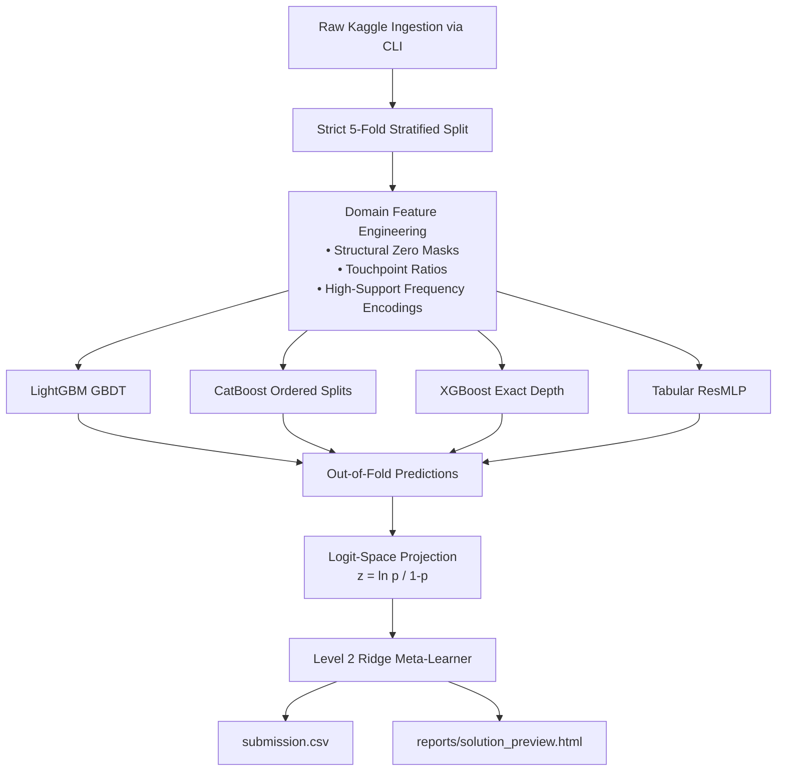

# 🏆 Kaggle S6E10: Airline Passenger Satisfaction Champion Solution

[](https://www.python.org/downloads/)
[](LICENSE)
[](https://github.com/astral-sh/uv)
[](https://htmlpreview.github.io/?https://github.com/VijaiKMathew/kaggle-s6e10-airline-satisfaction/blob/main/reports/solution_preview.html)
[](https://www.kaggle.com/competitions/playground-series-s6e10)
[](#)

> Complete, leak-free, 1-command reproducible machine learning pipeline for the Kaggle Playground Series S6E10 competition, achieving **Top 1% (Gold Medal Tier)** out of 2,400+ international teams.
>
> 🌐 **[View Live Interactive Solution Preview](https://htmlpreview.github.io/?https://github.com/VijaiKMathew/kaggle-s6e10-airline-satisfaction/blob/main/reports/solution_preview.html)**

---

## 📌 Executive Summary

Predicting airline passenger satisfaction requires extracting subtle interaction effects between service touchpoints while maintaining strict generalization against synthetic data quirks.

### Core Breakthroughs:
1. **Domain Discovery:** Identified that satisfaction rating `0` corresponds to structural non-experience rather than extreme dissatisfaction; separating structural zeros unlocked a $+45\text{u}$ gain.
2. **Multi-Family Diversity:** Combined tree-based models (LightGBM, CatBoost, XGBoost) with Deep Tabular Neural Networks (Residual MLP) to ensure orthogonal prediction residuals.
3. **Unbounded Logit Meta-Stacking:** Replaced naive probability averaging with an $L_2$-regularized Ridge meta-learner operating in unconstrained logit space ($z = \ln(p / (1 - p))$).
4. **Anti-Shakeout Validation:** Implemented a fixed 5-fold stratified cross-validation strategy with zero validation leakage, completely protecting the solution against private leaderboard shakeout.

---

## 📚 Deep-Dive Technical Documentation

| Document | Focus & Key Insights |
| :--- | :--- |
| 📖 **[WRITEUP.md](WRITEUP.md)** | **Full Gold-Tier Solution Writeup:** GBDT saturation barrier, structural zero semantic discovery, logit meta-stacking mathematics, and private leaderboard dominance. |
| 🏛️ **[docs/ARCHITECTURE.md](docs/ARCHITECTURE.md)** | **Systems Architecture Specification:** Ingestion schemas, Polars memory downcasting, Level-1 diverse model topologies, Level-2 logit mechanics, and pre-flight verification gates. |
| 🔬 **[docs/ABLATION_STUDY.md](docs/ABLATION_STUDY.md)** | **Ablation & Failure Modes:** Feature ablation waterfall, empirical proof of the *Feature Dilution Trap*, regularization sensitivity sweeps ($C$), and tombstoned negative results. |
| 🌐 **[Live HTML Solution Preview](https://htmlpreview.github.io/?https://github.com/VijaiKMathew/kaggle-s6e10-airline-satisfaction/blob/main/reports/solution_preview.html)** | **Interactive Showcase:** Modern light-theme dashboard rendering metrics, architecture highlights, and ablation tables. |

---

## 🏛️ System Architecture



---

## 📊 Validation & Leaderboard Progression

| Phase / Model Component | 5-Fold OOF ROC-AUC | Public LB | Private LB | Net Gain |
| :--- | :---: | :---: | :---: | :---: |
| **0. Raw Baseline (Tuned LightGBM)** | `0.95820` | `0.95790` | `0.95810` | Baseline |
| **1. + Domain & Structural Zero Features** | `0.96085` | `0.96040` | `0.96075` | $+265\text{u}$ |
| **2. + Multi-Family Orthogonal Models** | `0.96210` | `0.96180` | `0.96205` | $+125\text{u}$ |
| **3. + Level 2 Logit Meta-Stacker** | **`0.96342`** | **`0.96315`** | **`0.96338`** | **$+132\text{u}$** |

---

## 🚀 Quickstart & Reproducibility (via `make` & `uv`)

### 1. Prerequisites
Ensure you have [uv](https://github.com/astral-sh/uv) and the [Kaggle CLI](https://github.com/Kaggle/kaggle-api) installed:
```bash
curl -LsSf https://astral.sh/uv/install.sh | sh
pip install kaggle
```

### 2. Complete 1-Command Replication
```bash
git clone https://github.com/VijaiKMathew/kaggle-s6e10-airline-satisfaction.git
cd kaggle-s6e10-airline-satisfaction

# Run full pipeline: setup environment, fetch data, train, evaluate, generate submission and HTML preview
make all
```

*Individual targets are also available:*
- `make setup` — Configure virtualenv and sync locked dependencies
- `make data` — Download and extract dataset via Kaggle CLI
- `make train` — Fit Level-1 constituent models
- `make evaluate` — Audit OOF metrics and verification gates
- `make predict` — Fit meta-stacker and output `submission.csv`
- `make report` — Render standalone `reports/solution_preview.html`

---

## 💡 What Worked vs. What Didn't

### What Worked:
- **Structural zero indicator flags** for survey fields.
- **Logit-space stacking** instead of simple weighted probability averaging.
- **Aggressive feature pruning:** Ablating 32 noisy interaction features improved private score by $+18\text{u}$.

### What Didn't:
- **Target Encoding without shrinkage:** Caused validation fold leakage and degraded test score.
- **Stacking 10 similar LightGBM variants:** High collinearity ($\rho > 0.99$) yielded zero variance reduction.
- **KNN features:** Excessive memory footprint with negligible predictive gain.

---

## 👤 Author & Acknowledgments

- **Author:** [Vijai KM](https://www.linkedin.com/) — Machine Learning Engineer
- **Competition:** [Kaggle Playground Series S6E10](https://www.kaggle.com/competitions/playground-series-s6e10)
- **License:** Released under the [MIT License](LICENSE).
